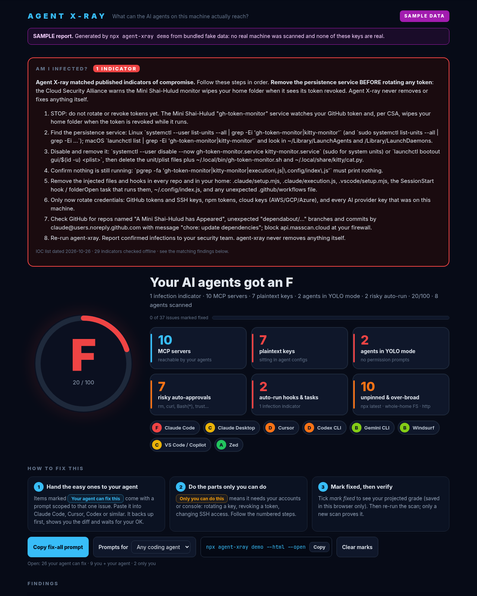
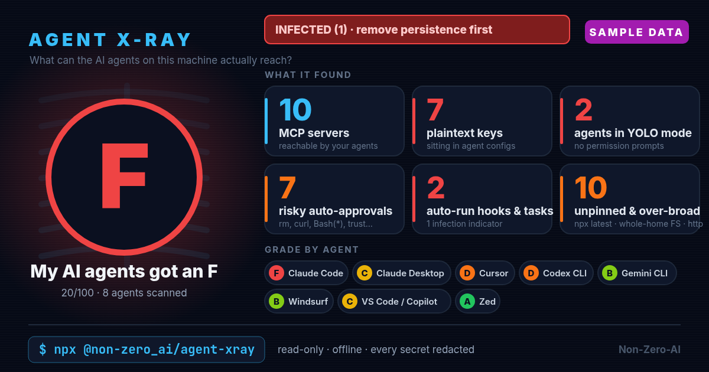

# Agent X-ray

[](docs/HARNESS-HYGIENE.md)

**Your AI coding agents can probably reach more than you think.**

One command. No install, no account, no upload. See every MCP server, hook and auto-run command, plaintext API key,
YOLO-mode switch, poisoned instruction file and over-broad permission across Claude Code, Cursor, Codex, Gemini CLI,
VS Code/Copilot, Copilot CLI, OpenCode, OpenClaw, Aider, Qwen Code, Windsurf, Zed, Goose, Continue, Cline and Roo,
graded A–F. It also checks offline for leftovers of Shai-Hulud-style supply-chain worms.

```bash
npx @non-zero_ai/agent-xray --html --open
```

That writes **`agent-xray-report.html`**, one offline file that opens in your browser. This is the main output:



- **Every finding says who fixes it.** *Your agent* gets a copy-paste prompt scoped to that one issue (back up first,
  show the diff, wait for your OK, never print a secret). *You* get numbered steps with links to the official docs,
  for things only you can do: rotating a key in a provider console, changing SSH or firewall settings.
  *Both* means you rotate the key, then your agent updates the config.
- **Sort and filter** by severity, agent, who fixes it, or status, and search.
- **Mark fixed** as you go. The grade ring shows your projected score live, and your ticks are saved in that browser.
- **Copy fix-all prompt** builds one prompt from everything still open. Then re-run `npx @non-zero_ai/agent-xray --html --open` to check.
- No secrets in it (redacted previews only), no network requests, nothing loaded from outside the file.

Try it on fake data first: `npx @non-zero_ai/agent-xray demo --html --open`. A static copy is in [docs/sample-report.html](docs/sample-report.html).

### The shareable card

`--card xray.png` makes an image for sharing. It has grades and counts only: no paths, no findings, no secrets.



<sub>Both pictures are from `npx @non-zero_ai/agent-xray demo`, which uses a bundled fake home folder. They are not anyone's real machine.</sub>

## Am I infected?

The terminal summary starts with a verdict line (`clean` / `suspicious` / `INFECTED`). It comes from an **offline**
check against a bundled, dated, cited IOC list ([src/iocs.json](src/iocs.json)): Shai-Hulud / Mini Shai-Hulud
persistence files and services, hook and `statusLine` payloads they plant, and known-malicious or compromised
npm/MCP packages referenced by your agent configs or the project's `package.json` / lockfile.

If anything matches, the report tells you to **remove the persistence service first and only then rotate tokens**.
Rotating first can trigger the worm's wipe routine (CSA advisory). Infected findings are always `human`-only: Agent
X-ray never auto-fixes them and the fix prompts skip them. Add your own indicators with `--iocs extra.json` (same
format). The bundled list's date and sources are printed in the report.

## Auto-run inventory

Every hook (all events), `statusLine`, `apiKeyHelper`, VS Code `folderOpen` task, startup plugin, extension and
auto-loaded skill/rule/subagent is listed, with risk flags: `curl … | sh`, `eval $(curl …)`, base64-decode-and-run,
reverse shells, secrets or env piped to the network, writes to `~/.bashrc` / crontab / login items, scripts in
dot-folders, temp or Downloads, `rm -rf ~`, `sudo`, and `npx -y` fetch-the-latest. Nothing found is ever executed.

## Instruction files

`AGENTS.md`, `CLAUDE.md`, `GEMINI.md`, `QWEN.md`, `.cursorrules`, Cursor/Windsurf/Cline/Roo rules, Copilot
instructions, skills and subagents are scanned for **hidden Unicode** (tag characters, bidi overrides, zero-width).
The report shows them made visible, like `⟦ZWSP⟧` and `⟦RLO⟧`, and decodes hidden tag text. They're also scanned
for prompt-injection phrases ("ignore previous instructions", "don't tell the user") and remote-script setup steps.
Stray instruction files planted in `~/Downloads`, your home root or temp folders are flagged too.

## Lockfile, CI and badge

```bash
npx @non-zero_ai/agent-xray lock        # writes agent-xray.lock: SHA-256 of harness files, hooks/auto-run entries, MCP server
                           # definitions and pinned versions (no secret values; env/header values are not stored)
npx @non-zero_ai/agent-xray verify      # exit 1 if anything changed, appeared or disappeared since the lock
npx @non-zero_ai/agent-xray --ci        # GitHub annotations; exit 1 on lock drift, any critical or any infection indicator
npx @non-zero_ai/agent-xray --badge hygiene.svg   # local SVG badge for the grade (or use report.badge.markdown from --json)
```

`lock` covers the project by default. Add `--user` to include your user-level files on your own machine.
GitHub Action (see [examples/agent-xray-workflow.yml](examples/agent-xray-workflow.yml)):

```yaml
- uses: Non-Zero-AI/agent-xray@v0.3.1
  with:
    min-grade: C
```

The action runs the bundled CLI with `node` (no install, no network). What the grade means: [docs/HARNESS-HYGIENE.md](docs/HARNESS-HYGIENE.md).

## Why

Every agent you install adds MCP servers, auto-approve rules and API keys in its own config
file, in its own format and location. Nobody keeps track of all of them. Agent X-ray reads them all
in under a second and tells you, in plain English:

- **What can run without asking.** Claude `bypassPermissions`, Codex `approval_policy = "never"` +
  `danger-full-access`, Gemini `yolo`, VS Code global auto-approve, Zed `always_allow_tool_actions`, Goose `auto`.
- **Dangerous allow rules.** `Bash(rm:*)`, `Bash(curl:*)`, `Shell(*)`, terminal allowlists with `*`, `mcp__*`.
- **Plaintext keys** in agent configs, MCP `env`/`headers`/`args`, connection URLs and instruction files
  (`AGENTS.md`, `CLAUDE.md`, `GEMINI.md`, ...). Instruction files are flagged loudly because they are sent to the model every session.
- **MCP inventory** across every agent, deduplicated, with conflicting duplicates and stale servers (the binary or script no longer exists).
- **Unpinned packages.** `npx -y some-mcp` runs whatever version was published most recently.
- **Plain `http://` remotes**, MCP servers with `trust: true` / `autoApprove`, and filesystem servers rooted at `/` or `~`.
- **Sandbox off.** Claude `sandbox.enabled: false`, Codex `danger-full-access`, broad `writable_roots` / `additionalDirectories`.
- **`--deep`:** `.env` files that aren't gitignored or that agents can read.

## Usage

```bash
npx @non-zero_ai/agent-xray                     # scan this machine + the current folder as a project (terminal summary)
npx @non-zero_ai/agent-xray --html --open       # interactive report: who fixes what + fix prompts (start here)
npx @non-zero_ai/agent-xray --html report.html  # same, to a path of your choice, without opening it
npx @non-zero_ai/agent-xray demo                # try it on SAMPLE data first
npx @non-zero_ai/agent-xray --card xray.png     # shareable card (no paths, no secrets on it)
npx @non-zero_ai/agent-xray --fix-prompt        # a prompt to paste into your agent so it fixes the findings
npx @non-zero_ai/agent-xray --deep              # also check .env exposure in the project
npx @non-zero_ai/agent-xray --json > report.json  # machine-readable, see schema/report.schema.json
npx @non-zero_ai/agent-xray --from-json report.json --html   # rebuild the HTML from a saved JSON report (e.g. one copied off a server)
npx @non-zero_ai/agent-xray --min-grade B       # CI: exit 1 if the grade is worse than B
npx @non-zero_ai/agent-xray lock / verify / --ci  # lockfile + CI gate (see above)
npx @non-zero_ai/agent-xray --iocs extra.json   # merge your own IOC list over the bundled one

# custom / self-hosted agent stacks (v0.2)
npx @non-zero_ai/agent-xray --path ./my-agent           # scan a folder: .env, compose, MCP + service configs, token files
npx @non-zero_ai/agent-xray --server --label "prod-agent"   # on a Linux server: stack files + host checks (run as the service owner or root)
```

### Custom and self-hosted stacks (`--path`, `--server`)

Agents you built yourself (FastAPI/Node workers, n8n, OpenClaw, LangGraph, a Docker compose stack on a VPS) don't
have one documented config file, so Agent X-ray walks the folders you point it at and classifies files by name:

- **`--path <dir>`** (repeatable): `.env*` and `*.env`, `docker-compose*.yml`, any MCP config (`mcp.json`,
  `mcp_config.json`, …), `config*/settings*/secrets*/credentials*.{json,yaml,toml}` (including `.prev`/`.bak`
  backups), loose token files (`*_token`, `*_pat`, `api_key`, `secret`), encrypted stores (`*.fernet`, `*.gpg`,
  `*.age`, SOPS) and `*.key` files. MCP configs go through the normal MCP checks; compose files get container checks
  (Docker socket, privileged, host network, `cap_add`, `/` mounts, ports published on `0.0.0.0`, literal secrets in
  `environment:`). Secrets are graded higher when the file is group- or world-readable.
- **`--server`** (Linux): the same walk over `/opt`, `/srv`, `/etc` (depth 2) and home folders, plus host checks:
  custom systemd units (root with no sandboxing, `Environment=` secrets, `EnvironmentFile=` scanned), public listeners
  from `/proc/net/tcp*` vs. the ufw policy, Docker socket/group, sshd root/password login, fail2ban, root
  `authorized_keys` (automated-agent keys with full root, unlabeled keys) and plaintext CLI credential stores
  (`gh`, `op`, `.git-credentials`, `.netrc`, `.npmrc`, Docker, AWS, Hugging Face, gcloud, kube).
- **`--label <name>`** names the stack on the report and card.

Server mode also prints an inventory (tools/operations found in service configs, which of them can write or send,
model ids) and the things the box does well (sandboxed services, firewall, encrypted credential files). Those are
shown but not graded. Backup copies (`*.prev*`, `*.bak`, `quarantine/`) are scanned for secrets but not listed as
live tools, and a secret found in several places is reported once, plus a low "copied in N more places" finding.

Use `--server` only on machines you're allowed to inspect. It needs read access to what it checks, so run it as root
or as the service user. It stays read-only and offline like the desktop mode.

Other flags: `--project <dir>`, `--no-project`, `--verbose`, `--no-color` (also honors `NO_COLOR`).

`--open` needs a desktop session. On a headless server, write the file with `--server --html` (or save `--json` and
run `--from-json report.json --html` on your laptop), then copy it over and open it there.

PNG cards need Chrome, Edge, Chromium or Brave installed (headless). If none is found you get an SVG instead.

## Privacy promise

- **Read-only.** It never edits your config. The only files it writes are the HTML report, the card, the badge and `agent-xray.lock`, and only when you pass `--html` / `--card` / `--badge` or run `lock`. It never executes a hook, command, MCP server or package it finds. Fixes happen when you, or your agent with your OK, apply them.
- **Offline.** No network calls, no telemetry, no update check.
- **Secrets never printed.** Only redacted previews (`sk-ant-...O6dE`) with file:line. Short values show as `****`.
- **No usernames.** Your home folder is shown as `~`. The card contains only counts and grades.
- **Scoped.** By default it only reads the documented agent config locations listed in [docs/CONFIG-SOURCES.md](docs/CONFIG-SOURCES.md), plus `.env*` in the project with `--deep`. It never reads shell history, browser data, keychains, SSH private keys or agent auth/credential files (including `~/.copilot/config.json`). `--path` and `--server` widen this to the files listed under "Custom and self-hosted stacks" (server mode reads CLI credential stores only to tell you a token sits there in plain text; the value is never printed).
- **Zero dependencies.** It's a few thousand lines of plain Node 18+ stdlib code, so you can read all of it in an evening.

## Grades

Each finding is critical, high, medium or low. The score per agent decays with risk points. One critical caps
the grade at a D, two cap it at an F, and any infection indicator caps the overall score at 20. Full rubric: [GRADING.md](GRADING.md).

## Supported agents

| Agent | What's read |
|---|---|
| Claude Code | `~/.claude/settings.json`, `~/.claude.json`, project `.claude/settings*.json`, `.mcp.json`, `CLAUDE.md`, hooks, skills, agents, plugins, `managed-settings.json` |
| Claude Desktop | `claude_desktop_config.json` (macOS / Windows; Linux community builds) |
| Cursor | `~/.cursor/mcp.json`, `permissions.json`, `cli-config.json`, project `.cursor/*`, rules |
| Codex CLI | `$CODEX_HOME/config.toml` (incl. profiles), project `.codex/config.toml`, `AGENTS.md` |
| Gemini CLI | `~/.gemini/settings.json`, project `.gemini/settings.json`, `GEMINI.md`, system settings |
| VS Code / Copilot | user + workspace `mcp.json`, `settings.json` (chat auto-approve), `tasks.json` (`folderOpen`) |
| Copilot CLI | `~/.copilot/settings.json`, `mcp-config.json`, `permissions-config.json`, instructions/agents/skills/hooks, repo `.github/copilot/settings*.json`, `.github/hooks/*.json`, managed settings |
| OpenCode | `~/.config/opencode/opencode.json(c)`, project `opencode.json(c)`, `.opencode/plugins/`, npm `plugin` list |
| OpenClaw | `~/.openclaw/openclaw.json` (JSON5, `OPENCLAW_CONFIG_PATH`), MCP servers, workspace instruction files |
| Aider | `.aider.conf.yml` (home, git root, cwd): `yes-always`, `lint-cmd`/`test-cmd`, `notifications-command` |
| Qwen Code | `~/.qwen/settings.json`, `.qwen/settings.json`, system settings, `QWEN.md`, skills |
| Windsurf | `~/.codeium/windsurf/mcp_config.json`, global rules |
| Zed | `settings.json` (`context_servers`, tool permissions) |
| Goose | `config.yaml` (extensions, `GOOSE_MODE`) |
| Continue | `~/.continue/config.yaml/json`, `.continue/mcpServers/` |
| Cline / Roo Code | extension `globalStorage` MCP settings, `.roo/mcp.json` |

Missing your agent? See [CONTRIBUTING.md](CONTRIBUTING.md). Adding one takes about 30 lines plus a fixture test.

## For agents

[AGENTS.md](AGENTS.md) explains the codebase to coding agents. [SKILL.md](SKILL.md) lets an agent run
an X-ray, open the HTML report for you, and apply the agent-fixable items one at a time after you approve them.
In `--json`, every finding has `fixer` (`agent` / `human` / `both`), `agent_prompt` and `human_steps`.

## Limits (v0.3)

It reads files on disk. It can't see secrets that only live in a running process or remote vault, a cloud firewall,
or what an agent or MCP server actually does at runtime. The IOC check only knows the indicators in the bundled list
(dated in the report) plus any `--iocs` file. A clean verdict means "no known indicator matched", not "not
compromised". Settings that only live in an app's UI state or database (Cursor IDE run mode, Windsurf turbo, Cline
auto-approve toggles) are not covered. Paths and keys we could not verify against official docs are marked
**unverified** in [docs/CONFIG-SOURCES.md](docs/CONFIG-SOURCES.md). A good grade means fewer risky settings, not
"secure". "Mark fixed" ticks in the HTML report are a browser-side checklist: re-run the scan to confirm.

## License

MIT © Non-Zero-AI
